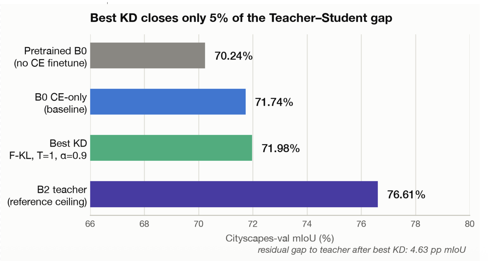
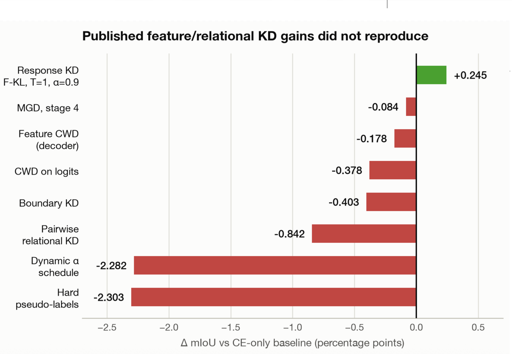
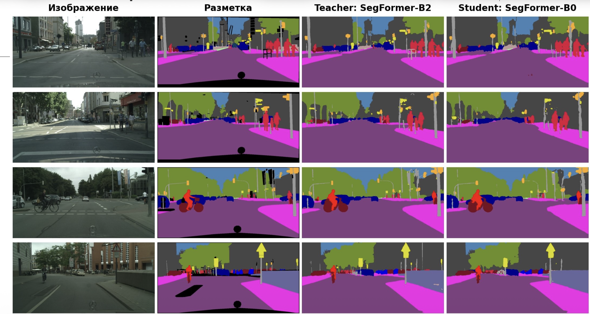
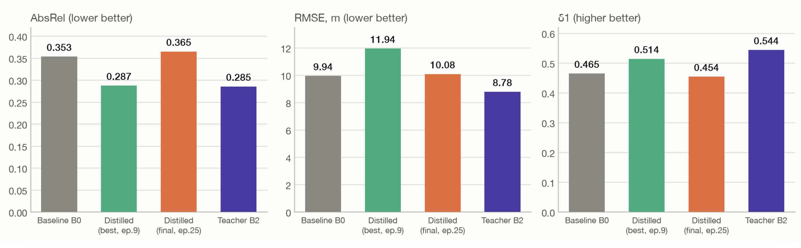

# Knowledge Distillation for Computer Vision

We tested how closely the smaller SegFormer-B0 could match SegFormer-B2 on semantic segmentation and depth estimation.

## Semantic segmentation

On Cityscapes-val, distilling the teacher's outputs (forward KL, T=1, α=0.9) raised mIoU from **71.74% to 71.98%**, closing about **5% of the gap** between the cross-entropy baseline and B2 (**76.61%**). Feature-based and relational distillation yielded no gains in these experiments.

## Depth estimation

At epoch 9, AbsRel fell from **0.353 to 0.287**, close to B2's **0.285**, and δ₁ rose from **0.465 to 0.514**. RMSE increased from **9.94 to 11.94 m**. By epoch 25, all three metrics were worse than the B0 baseline.

## Deployment

The TensorRT engine on an NVIDIA V100 produced identical segmentation masks, with **7.23 ms** median latency and **171.9 images/s** across 8 parallel streams.

[Presentation (PDF, in Russian)](presentation.pdf)
